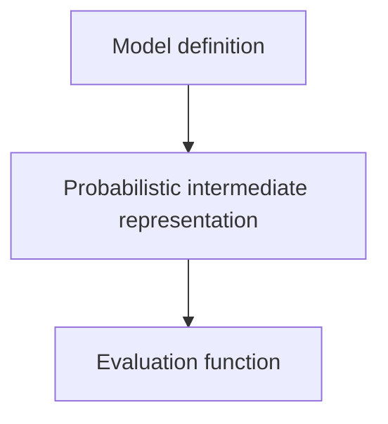

# Runtime generated functions

One of Wren's unique features is that it uses staged computation to generate the evaluation functions for models.
That sounds like a scary term, but it essentially means that the evaluation function is not generated in a single shot but rather in a multi-stage pipeline:



The model definition is what you write:

```@example rgfs
using Wren, Wren.Dists

@wren function my_model(y)
    x ~ Normal()
    @observe y ~ Normal(x)
end

model = my_model(1.0)
```

The probabilistic IR looks something like the following, but a bit more complicated:

```julia
[Sample(:x, :(Normal())), Observe(:y, :(Normal(:x)))]
```

!!! details "The actual IR"

    Although it's not really useful for the average user, you can view this if you want with

    ```@example rgfs
    dump(model.stmts)
    ```

And the evaluation function is conceptually something like

```julia
function __mymodel_evaluate__(y, params, accs, ...)
    x = rand(Normal())
    lp_x = logdensityof(Normal(), x)
    accs = add_logprior(accs, lp_x)
    lp_y = logdensityof(Normal(x), y)
    accs = add_loglikelihood(accs, lp_y)
    return accs
end
```

!!! details "The actual IR"

    Again, although it's not really useful for the average user, you can view this if you want with

    ```@example rgfs
    using WrenCore
    
    WrenCore.view_evaluation_fn(model)
    ```
