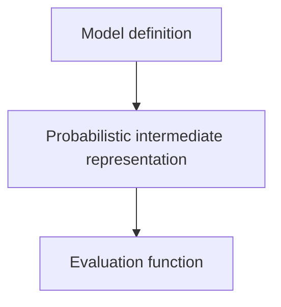

# Staged computation

One of Wren's unique features is that it uses staged computation to generate the evaluation functions for models.
That sounds like a scary term, but it essentially means that the evaluation function is not generated in a single shot but rather in a multi-stage pipeline:



The model definition is what you write:

```@example rgfs
using Wren, Wren.Dists

@wren function my_model(y)
    x ~ Normal()
    @observe y ~ Normal(x)
end

model = my_model(1.0)
```

The probabilistic IR looks something like the following, but a bit more complicated:

```julia
[Sample(:x, :(Normal())), Observe(:y, :(Normal(:x)))]
```

!!! details "The actual IR"

    Although it's not really useful for the average user, you can view this if you want with

    ```@example rgfs
    dump(model.stmts)
    ```

And the evaluation function is conceptually something like

```julia
function __mymodel_evaluate__(y, params, accs, ...)
    x = rand(Normal())
    lp_x = logdensityof(Normal(), x)
    accs = add_logprior(accs, lp_x)
    lp_y = logdensityof(Normal(x), y)
    accs = add_loglikelihood(accs, lp_y)
    return accs
end
```

!!! details "The actual IR"

    Again, although it's not really useful for the average user, you can view this if you want with

    ```@example rgfs
    using WrenCore
    
    WrenCore.view_evaluation_fn(model)
    ```

## Why do this?

This pipeline does seem complicated.
In particular, one might ask why we don't just generate the evaluation function directly from the model definition.
(Indeed, a macro would do this quite easily, and that's more or less how DynamicPPL works, for example.)

The main motivation is that the intermediate representation (IR):

  - gives Wren some information about the model which it can use to (more efficiently) generate the evaluation function;
  - allows Wren to do some optimisations, for example [elision of submodel parameter collection](@ref submodel-performance);
  - allows for the programmatic generation of Wren models, in that a user can construct an IR and then generate a Wren model from it, instead of having to do some macro gymnastics to create the original model definition.

This of course doesn't come for free.
Besides the substantial extra complexity of the codebase, it also means that we have to use [RuntimeGeneratedFunctions.jl](https://github.com/SciML/RuntimeGeneratedFunctions.jl) in the second step (IR to evaluation function), which brings with it some limitations.
For example, model bodies cannot close over local variables (only global variables).
This is surprisingly easy to trigger:

```@repl rgfs
for d in (Normal(), Exponential())
    @wren function oops_closed_over_local()
        x ~ d
    end

    model = oops_closed_over_local()
    rand(model)
end
```

This can of course be worked around, for example by passing `d` into the model as an argument.
However, it's still of course a limitation, and the error message isn't super helpful either.

## IR design

TODO.

## Programmatic generation

The above claim that the IR *allows* for programmatic generation is very carefully worded: there is no meaningful API for this yet.

However, you can in principle do something like this:

```@example rgfs
using WrenCore.Expressions: Sample, Observe, AbstractWrenExpr
using WrenCore: RuntimeGeneratedFunctions

stmts = AbstractWrenExpr[
    Sample(:sample_x, :x, Normal(), :x, true),
    Observe(:observe_y, :y, :(Normal(x))),
]

RuntimeGeneratedFunctions.init(@__MODULE__)
manual_model = Wren.Model(:my_model, (; y=1.0), stmts, @__MODULE__)
```

Obviously, this leaks internal details of Wren, and is not exactly a user-friendly API.
However, it does show that it should be possible to construct the `stmts` array programmatically, generate a Wren model from it, and then use that model:

```@example rgfs
rand(manual_model)
```
