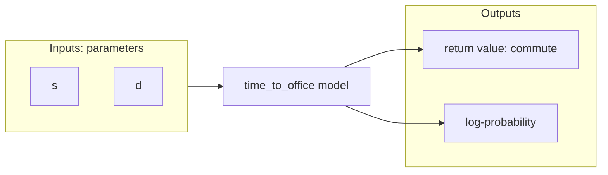

# Probabilistic programming

This page is intended to be a very gentle introduction to what probabilistic programming is all about.

If you are already familiar with other probabilistic programming languages, you may want to skip ahead to the [Syntax and semantics](@ref syntax) page.

We assume here that you have a basic understanding of probability distributions (e.g. the normal and Bernoulli distributions), and that you can read Julia code.

## Probabilistic functions

'Probabilistic programming' really just means that we can represent the idea of probability or nondeterminism in our programming language.
There are in fact many ways of doing this!
The simplest is to just write a function that calls `rand()` directly:

```@example beginner
using Wren.Dists
using Random

function probabilistic_basic(rng=Random.default_rng())
    x = rand(rng, Normal(0, 1))
    return (; x)
end

probabilistic_basic()
```

Each time you call this function, it will return a different value for `x`:

```@example beginner
[probabilistic_basic() for _ in 1:5]
```

!!! note "Pseudo-random number generators"

    Technically, the `rand` function is not _truly_ random, but rather [_pseudo-random_](https://en.wikipedia.org/wiki/Pseudorandomness).
    This means that it takes an input value (a 'seed'), and uses that to deterministically generate a sequence of numbers that appear to be random.

    This might seem like a very bad thing to do, but in fact it's very important: it means that we can reproduce our results exactly by running it with the same seed.
    This can often help with debugging, but even more crucially, it also allows others to verify that your results are correct!

Now, Wren provides a `@wren` macro, which lets you write code that represents the same idea of having a random variable `x`:

```@example beginner
using Wren

@wren function probabilistic()
    x ~ Normal(0, 1)
    # and so on
end

model = probabilistic()
rand(model)
```

The output type is slightly different from above, but conceptually you can see that it's still a container that has a value for `x`.

!!! note "Domain-specific language"

    Technically speaking, Wren is not a full programming language in and of itself: you might also hear the term *domain-specific language* (DSL) used for libraries like Wren.
    This means that it has some syntax of its own (e.g. the `~` operator) which is intended for a specialised use case (representing a probability distribution).
    However, it is *embedded* within a host language (Julia), which means that you can also use Julia code inside the Wren model.

## Forward simulation

A probabilistic model allows us to write down a relationship between a model's _variables_—its parameters, which we can't directly see—and the _observations_ which we do see.

The best way to understand this is to construct a simple (and sadly very realistic) example.
To get to work each morning, I have to take [the train](https://en.wikipedia.org/wiki/London_Underground) to work.
Although the train is usually pretty reliable, [there are often delays](https://tfl.gov.uk/tube-dlr-overground/status/).
This introduces some randomness into my commute time.

For example, we might say that the time I spend on the train is 30 minutes, plus some `delay` that's between 0 and 15 minutes.
Assuming that every possible value for the delay is equally likely, we could write this as:

```math
t = 30 + d, \quad d \sim \text{Uniform}(0, 15)
```

Here, `Uniform(0, 15)` represents the uniform distribution between the bounds 0 and 15, and the `~` symbol means 'is distributed as'.

Unfortunately for me, I might also sometimes oversleep!
Let's say that the chance of me oversleeping is 10%.
Then `s`, which is a number indicating whether or not I overslept, can be represented as a Bernoulli distribution.
Specifically, 0 means I woke up on time, and 1 means I overslept:

```math
s \sim \text{Bernoulli}(0.1)
```

If I oversleep, then I will leave the house ten minutes late.
Altogether, that means that my total commute time `commute` can be represented as:

```math
commute = 30 + d + 10s
```

Let's first write out the 'basic' version of this function in Julia code:

```@example beginner
function time_to_office_basic(rng=Random.default_rng())
    s = rand(rng, Bernoulli(0.1))   # Oversleep
    d = rand(rng, Uniform(0, 15))   # Train delay
    commute = 30 + d + (s * 10)     # Total commute time
    return commute
end
```

We can use this function to generate random samples of my commute time `commute` by calling it multiple times.
This is often referred to as *forward sampling* or *forward simulation*, because we're simply drawing new values for `s` and `d`, and then running the function forwards to get values of `commute`:

```@example beginner
[time_to_office_basic() for _ in 1:5]
```

Let's turn this into a Wren model.
For now, don't worry too much about the exact syntax; however, you should notice that the code we wrote is very similar to the mathematical expressions above.

```@example beginner
@wren function time_to_office()
    s ~ Bernoulli(0.1)            # Oversleeping
    d ~ Uniform(0, 15)            # Train delay
    commute = 30 + d + (s * 10)   # Total commute time
    return commute
end

model = time_to_office()
```

This model has two _parameters_: `s` and `d`.
Note that `commute` is not a parameter of the model, because it is fully deterministic: given values for `s` and `d`, we can compute the value of `commute` exactly.

If we wanted to perform forward sampling with this model, Wren provides a `return_value` function, which calculates the value of `commute` (since that is what the model returns):

```@example beginner
[return_value(model) for _ in 1:5]
```

## Tracking probabilities

At this point, you might well wonder what is the point of all this: surely our 'basic' functions that call `rand()` directly are already just as good as the 'fancy' Wren models!

However, it turns out that Wren models hide a lot of extra power that isn't immediately obvious.
Behold:

```@example beginner
result = simulate(model)
```

The [`simulate`](@ref) function returns a bundle of not only the model's return value, but also the corresponding values of the parameters `s` and `d`, as well as the probability of those values occurring.
(We always track the logarithm of the probability rather than the probability itself: this allows us to accurately represent very small probabilities.)

We can see that all the information is consistent with the model that we wrote above.
In particular, the return value is clearly equal to `30 + d + 10s`.
Furthermore, the probability (in this case the 'log-prior'—we'll explain that later) is the sum of the individual log-densities, which we can calculate using `Wren.logdensityof`:

```@example beginner
# Get the values of `s` and `d`. Again, don't worry too much about the
# exact syntax here, except to convince yourself that we are indeed
# performing some sort of lookup to get the values of the named parameters.
result_s = parameters(result)[@vn(s)]
result_d = parameters(result)[@vn(d)]

# Calculate the associated log-density.
logdensityof(Bernoulli(0.1), result_s) + logdensityof(Uniform(0, 15), result_d)
```

You certainly _could_ have done this yourself by extending the 'basic' function to store the values of `s` and `d` and include the calls to `logdensityof`.
However, Wren does all this automatically for you, and you don't have to modify your model to do so.

Essentially, in writing the model, you have given Wren something akin to a description of the model.
Wren then uses that description to automatically generate the code which samples new values for the parameters, calculates the return value, and tracks the log-probability of those parameter values.

Before we go on, it's worth noting that the return value, as well as the log-probability, are considered to be _outputs_ of the model.
These are both functions of the parameters, which one may think of as the _inputs_ to the model.



!!! note "Using specific parameter values"

    So far, we have always generated fresh inputs for the model each time we ran the simulation—i.e., fresh values for `s` and `d`—by drawing from their distributions.
    (That is what `return_value` and `simulate` do if not given any other arguments.)

    However, it is often also very useful to be able to evaluate the model for a specific set of inputs.
    (We won't go into detail here, but this is often used in various inference algorithms, such as Markov chain Monte Carlo.)
    This is another reason why Wren is more powerful than the 'basic' function: it allows you to replace the calls to `rand(distribution)` values that are specified ahead of time.
    You could do this in the 'basic' version by supplying an optional argument, checking its value, and then calling `rand` only if it is not provided.
    But this gets quite cumbersome very quickly!

## Inference

You might now be wondering why we might care about the probability of the parameters.
You might also wonder what is the 'log-likelihood' field in the `ModelResult` object above, which is currently zero.
It turns out that both of these are very much related.

Broadly speaking, the log-prior is the probability density associated with the parameters themselves.
That's why the log-densities of `s` and `d` were counted under the `logprior` field.

TODO(penelopeysm)

  - Add an observation to the model and its distribution.
  - Describe how loglike and logprior relate to the terms in Bayes theorem
  - Explain that the logposterior is just the sum (modulo constant)
  - We can use both together to do inference, i.e., figure out the most likely values of parameters given the observations.
  - Demo with a simple importance sampler

## Further reading

For more information about probabilistic programming and Bayesian inference, you might want to check out the various resources listed on the [Learn Bayes website](https://learnbayes.se/learn/resources/).
